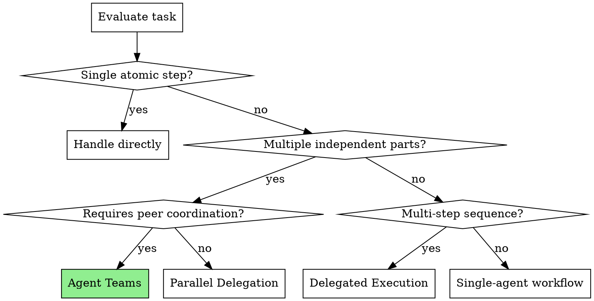

# Activation

<CRITICAL-OVERRIDE>
Invoke every applicable skill **before** generating a response or taking an action — including before asking a clarifying question. A marginal chance of relevance is sufficient reason to invoke. If the skill turns out not to apply, move on.
</CRITICAL-OVERRIDE>

A question is a task. Reading files is a task. Anything you are about to do is a task, and the skill defines *how* to do it — so it comes first, not after you have already started.

## Accessing skills

Invoke through the `Skill` tool: `Skill("ascension:intent-discovery")`.

If the tool cannot locate a protocol, read it directly: `[plugin-root]/skills/<name>/SKILL.md`, where the plugin root is `CLAUDE_PLUGIN_ROOT` when installed, or the working directory when running from the repository.

Announce what you are doing — *"Applying fault-diagnosis to find the cause"* — and track any checklist the skill contains as real tasks.

## The map

Most work travels one route. Two on-ramps merge onto it; the rest stand alone.

**The main flow — idea to shipped**

```
rationale → intent-discovery (grilling + reference-engine + prototype)
          → task-planning → work-tickets (when it exceeds one session)
          → implementation (minimalism + test-first + pattern-matching)
          → quality-gate → completion-gate → merge-protocol
```

`rationale` asks whether the work is worth doing at all. `intent-discovery` turns the idea into an agreed design. `task-planning` turns the design into a plan; `work-tickets` slices that plan into tracer bullets when it is too big for one session. Implementation runs `minimalism` (how much to build) alongside `test-first` (proving it) and `pattern-matching` (matching the codebase). `quality-gate` reviews on two axes, `completion-gate` demands evidence, `merge-protocol` lands it.

**Two questions the flow asks that are easy to skip.** *Does this need to exist?* — `minimalism`, before any code. *Is this diff bigger than the change warranted?* — `overbuild-review`, after it.

**On-ramps**

| Situation | Entry point |
|---|---|
| Something is broken | `fault-diagnosis` — build a tight loop before theorising |
| Attempts are looping, complexity rising | `error-recovery` |
| A merge or rebase has stopped | `merge-conflicts` |
| A decision waits on external facts | `primary-research` |
| A design question needs to be seen or driven | `prototype` |
| The codebase has drifted into over-engineering | `overbuild-review` |
| A question spans many files or a large payload | `think-in-code` — script the answer, do not read it |

**Underneath everything**

`vocabulary` (the shared words), `domain-modeling` (this project's language and its ADRs), `module-design` (module, interface, depth, seam, adapter), `canon` (fourteen engineering books as applicable rule sets), `context-economy` (what to do at a phase boundary), `protocol-authoring` (writing skills themselves). Reach for these when the *words*, the *shape*, or the *governing principle* are the problem, not the process.

## Ordering

When several skills apply:

1. **Challenge** — `rationale`: is this worth doing?
2. **Process** — `intent-discovery`, `fault-diagnosis`: establish the approach.
3. **Reference** — `reference-engine` routes to `ux-patterns`, `design-research`, `github-search`, `codebase-research`, `primary-research`, `canon`, `system-design`, `deployment-advisor`.
4. **Design** — `ui-engineering`, `design-integration`, `specification-first`, `module-design`, `canon`.
5. **Implementation** — `minimalism`, `test-first`, `project-bootstrap`, `pattern-matching`, `environment-awareness`.
6. **Quality** — `quality-enforcement`, `security-protocol`, `quality-gate`, `overbuild-review`, `completion-gate`, `comprehension-check`.
7. **Orchestration** — `team-orchestration`, `delegated-execution`, `parallel-execution`.

Bugs skip `rationale` and start at `fault-diagnosis`.

## Execution mode

When the user says "use ascension", evaluate the task and propose the execution strategy before acting.



Present it as a recommendation with a reason, and let the user redirect.

## Watch the session length

The agent gets less sharp as context grows, gradually and without announcing it. When the session is long, when instructions from earlier start slipping, or when a phase has just ended, call the Skill tool with "ascension:context-economy" and make the decision deliberately rather than pushing on degraded.

## YoloMode

Triggered by "yolo", "just go", "just do it", "go for it", "skip the questions", "you decide", "auto-pick".

Active behaviour: compress `intent-discovery` to survey, research, and a recommended approach without per-section confirmation; run `rationale` but present it concisely; skip confirmation prompts.

**Still pauses for the user:** any skill presenting labelled A/B/C options.
**Still runs in full:** `completion-gate` and test execution, `security-protocol`, `quality-enforcement`, and the confirmation before any destructive operation in `merge-protocol`.

YoloMode trusts your recommendation on design choices, not on safety checks.

## Two things to keep straight

**A user directive says WHAT, not HOW.** "Add X" or "Fix Y" specifies the outcome; it does not authorise bypassing the workflow that gets there well.

**Recalling a skill is not running it.** Skills change. Read the current version.
