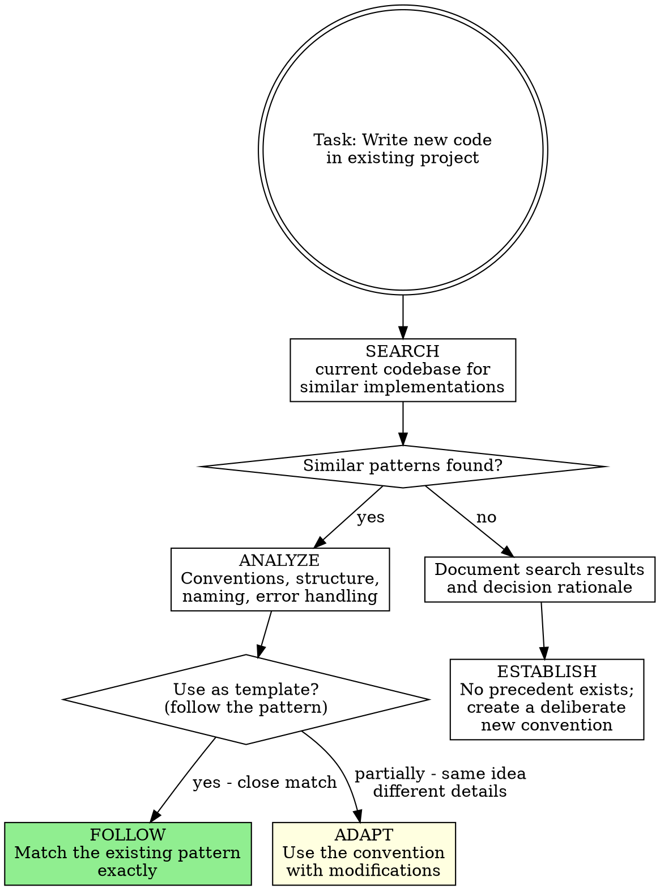

# Codebase Research

## Overview

Before writing new code in an existing project, understand what already exists inside it. The codebase itself is the most authoritative reference for how things should be built. Every project accumulates conventions, patterns, and implicit standards that new code must respect.

Search the current codebase before coding: find similar files, functions, and patterns, and match the existing conventions exactly, so each thing is done one way throughout the project.

## When to Use

- Adding a new feature to an existing codebase
- Creating a new file, component, module, or service
- Implementing a pattern that likely exists elsewhere in the project
- Writing tests for existing functionality
- Adding error handling, logging, or validation logic

## The Entry Protocol



**BEFORE writing new code in an existing project:**

1. **SEARCH** -- Query the codebase for similar files, functions, patterns, and conventions
2. **ANALYZE** -- Study how existing code handles the same concerns
3. **MATCH** -- Align your new code with established conventions
4. **BUILD** -- Write code that looks like it belongs in the project

Done when at least 2 similar files have been read and every item in the Analysis Checklist has either an answer taken from the codebase or a note that no precedent exists.

## Search Methodology

### What to Search For

When about to create something new, search the codebase for each of these:

| Search Target | Why | How |
|---|---|---|
| **Similar files** | Find the template to follow | Glob for files with similar names or in similar directories |
| **Similar functions** | Match function signatures and patterns | Grep for functions that do analogous work |
| **Imports and dependencies** | Use what the project already uses | Grep for import statements to find established libraries |
| **Error handling** | Match the project's error patterns | Grep for try/catch, Result types, error classes |
| **Naming conventions** | Use the same casing and terminology | Read adjacent files, check for camelCase vs snake_case vs kebab-case |
| **File organization** | Place new files where they belong | List directory structures, find where similar code lives |
| **Test patterns** | Write tests the way the project writes tests | Find test files for similar modules, match their structure |
| **Configuration patterns** | Match config approaches | Search for .env usage, config files, constants |

### Search Techniques

**Structured search sequence** -- Follow this order for thorough coverage:

```
1. DIRECTORY SCAN: List files in the relevant directories
   -> Understand the project's file organization

2. SIMILAR FILE SEARCH: Glob for files with similar names or purposes
   -> Find the closest existing template for what you need to build

3. PATTERN GREP: Search for specific patterns you plan to use
   -> Confirm the project's approach to that pattern

4. IMPORT ANALYSIS: Check what libraries and utilities are already imported
   -> Use existing dependencies rather than introducing new ones

5. TEST FILE REVIEW: Find tests for similar functionality
   -> Match the testing approach, assertion style, and setup patterns
```

**Minimum threshold before writing new code:** Review at least 2 similar files in the codebase.

## Convention Matching

### The Consistency Principle

When the codebase does something one way, you do it the same way. Project consistency outweighs personal preference.

| Dimension | Match Exactly |
|---|---|
| **Naming** | Variable names, function names, file names, class names |
| **Structure** | File layout, directory organization, module boundaries |
| **Patterns** | How the project handles state, errors, async, validation |
| **Style** | Formatting, comment style, documentation approach |
| **Dependencies** | Use the project's existing libraries, not alternatives |
| **Testing** | Test framework, assertion library, setup/teardown approach |
| **Error handling** | Throw vs return, error types, error messages |

### Common Convention Signals

```
LOOK FOR these indicators of established conventions:

- Linter/formatter config (.eslintrc, .prettierrc, rustfmt.toml, etc.)
  -> These are explicit rules. Follow them exactly.

- Shared utility files (utils/, helpers/, lib/, common/)
  -> These are the project's building blocks. Use them.

- Base classes or interfaces (BaseController, AbstractService)
  -> These define the inheritance/composition pattern. Extend them.

- Barrel files (index.ts, __init__.py, mod.rs)
  -> These define the export pattern. Add to them.

- Test helpers (test/helpers/, fixtures/, factories/)
  -> These are the testing infrastructure. Build on them.
```

## Analysis Checklist

When you find similar code in the codebase, extract answers to these questions:

```
1. FILE PLACEMENT: Where does this type of file live?
   -> Same directory? Nested by feature? Grouped by type?

2. FILE NAMING: What naming pattern does the file follow?
   -> ComponentName.tsx? component-name.ts? component_name.py?

3. EXPORTS: How are things exported?
   -> Default export? Named exports? Re-exported from barrel?

4. FUNCTION SIGNATURES: What do similar function signatures look like?
   -> Parameter ordering, return types, async vs sync

5. ERROR HANDLING: How does this part of the codebase handle errors?
   -> Try/catch? Result types? Error callbacks? Thrown exceptions?

6. LOGGING: Does the project have a logging pattern?
   -> Logger instance? Console methods? Structured logging?

7. VALIDATION: How does the project validate input?
   -> Zod? Joi? Manual checks? Type guards?

8. STATE MANAGEMENT: How is state handled?
   -> Redux? Zustand? Context? Signals? Local state?

9. TESTING APPROACH: What do tests for similar code look like?
   -> Unit tests? Integration? What assertion library?

10. DOCUMENTATION: Are there JSDoc comments, docstrings, or inline docs?
    -> Match the existing documentation density and style.
```

## When No Precedent Exists

Sometimes you are genuinely building something the codebase has never done before. In that case:

1. **Confirm absence** -- Search at least 3 different ways to be sure no precedent exists
2. **Check adjacent projects** -- If this is a monorepo, check sibling packages
3. **Consult external sources** -- Call the Skill tool with "ascension:github-search" to find patterns from public repositories
4. **Establish deliberately** -- When creating a new convention, make it consistent with the spirit of the existing codebase
5. **Document the decision** -- Note why a new pattern was introduced

## Integration with Other Skills

### During Intent Discovery

When ascension:intent-discovery is exploring the project landscape:

1. **Search the codebase** for existing implementations related to the proposed feature
2. **Report conventions** that the new feature must follow
3. **Identify reusable code** -- utilities, components, and services that already solve part of the problem

### During Implementation

When writing code after design approval:

1. **Find the template file** -- the closest existing file to what you need to create
2. **Copy the structure** -- match the template's organization exactly
3. **Swap the specifics** -- replace domain details while preserving the pattern
4. **Verify consistency** -- compare your new file against the template to catch deviations

## Guardrails

- Read at least 2 similar files before writing new code.
- Match the naming conventions of the surrounding code exactly.
- Use the project's existing libraries and shared utilities; when the project already has an equivalent, use it rather than adding a new dependency or a duplicate helper.
- Place new files where the existing organization puts their kind.
- Write tests the way the project's tests for similar modules are written.
- Document what you searched when no precedent exists in the codebase.
- When the existing pattern looks outdated or not to your taste, match it now and propose a refactor or migration as a separate task.
- Treat small utilities with the same care as modules: they are the most reused code, so their pattern spreads furthest.

## Surveying without flooding the window

When a research question is aggregate — how many, which files, what changed most, which modules import this — compute the answer with a script and print only the result. Call the Skill tool with "ascension:think-in-code". Reading forty files to count something spends the session's attention on arithmetic.

Read files when you need to *understand* them. Script the answer when you need to *tally* them.

## Related

Routed here by `ascension:reference-engine` and by `ascension:intent-discovery` during its project survey. `ascension:github-search` is the same discipline pointed at external repositories; `ascension:pattern-matching` goes deeper on matching once the conventions are found.
