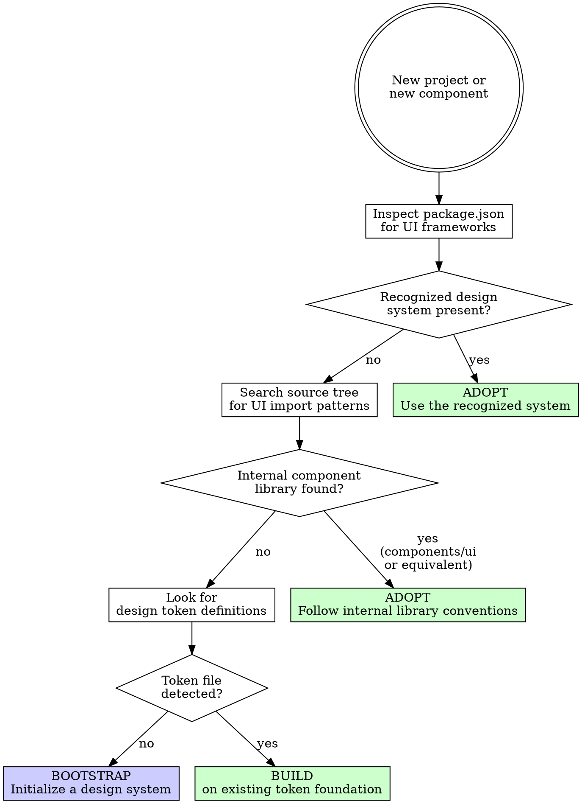

# Design Integration

## Overview

Detect the project's design system, work inside it, and extend it only through its own extension points. A component built beside the system is the failure this skill prevents: it looks almost right, drifts on its own schedule, and multiplies.

When a project has a design system, every component you create consumes that system's primitives, tokens, and patterns. When no system exists, establish one before writing components.

## When to Use

- Entering any existing codebase with a user interface
- Introducing new UI elements to an established application
- Growing a project's component library
- Initializing a new project that will have a UI layer

Specific triggers: imports from `@shadcn/ui`, `@mui/material`, `antd`, `@chakra-ui`, or equivalents; a `components/ui` directory containing base-level primitives; configuration files such as `tailwind.config`, `theme.ts`, or a design token file.

## The Entry Protocol

Before authoring any UI component:

1. **Detect** which design system governs this project (Detection Sequence below). Done when you can name the system, the internal library, or the token file, or have confirmed none exists.
2. **Study** the system's component API for the element you are building.
3. **Assess** whether the system already provides this component:
   - Yes: consume it directly.
   - Partially: compose it from existing primitives.
   - No: build it to the system's conventions (Extension below).
4. **Validate** that the component reads as native to the system: same naming, same styling mechanism, same token references, same accessibility patterns.

Done when the new component imports only the system's primitives and tokens and introduces no styling mechanism the system does not already use.

## Detection Sequence



### Phase 1: Inspect Dependencies

| Dependency | System | Approach |
|---|---|---|
| `@radix-ui/*`, `class-variance-authority` | shadcn/ui | Adhere to shadcn file and variant conventions |
| `@mui/material`, `@emotion/react` | Material UI | Follow Material Design specifications |
| `antd` | Ant Design | Follow Ant component patterns |
| `@chakra-ui/react` | Chakra UI | Follow Chakra theming and style props |
| `@headlessui/react` | Headless UI | Pair with Tailwind for styling |
| `@mantine/core` | Mantine | Follow Mantine hook and component patterns |
| `primereact`, `primevue` | PrimeReact/PrimeVue | Follow Prime theming and template system |

### Phase 2: Scan for Internal Components

Look for:
- `components/ui/` directory (typical shadcn/ui layout)
- `components/common/` or `components/shared/`
- Barrel re-exports from component directories
- Storybook stories (`.stories.tsx`)

### Phase 3: Locate Design Tokens

Search for:
- `tailwind.config.js/ts` (Tailwind CSS theme customization)
- `theme.ts` or `theme.js` (custom theme objects)
- CSS custom properties defined on `:root` or `[data-theme]`
- `tokens/` or `design-tokens/` directories
- `styles/variables.css` or `styles/tokens.css`

## Adoption: Operating Within an Existing System

### Universal Principles

1. **Consume the component API as-is.** Do not add wrapper elements with inline overrides.
2. **Use the system's variant mechanism.** If it offers `variant="danger"`, use that instead of manually overriding colors.
3. **Use the system's sizing props.** If it accepts `size="sm"`, do not override with custom CSS.
4. **Extend through the system's designated extension points.** Not through CSS specificity wars.
5. **Follow the system's directory conventions.** If primitives live in `components/ui/`, new ones go there too.

### shadcn/ui

Copy-and-customize components built on Radix UI + Tailwind CSS.

**Conventions:**
- Primitives in `components/ui/` (base building blocks)
- Application components in `components/` (composed from primitives)
- `cn()` helper for merging class strings and conditional class composition
- `cva()` from `class-variance-authority` for variant definitions
- All styling through Tailwind utility classes

**Adding a missing component:**
```bash
npx shadcn@latest add [component-name]
```

**Composing custom components:**
```tsx
import { Card, CardContent, CardHeader, CardTitle } from "@/components/ui/card"
import { Badge } from "@/components/ui/badge"

export function ProjectCard({ project }) {
  return (
    <Card>
      <CardHeader><CardTitle>{project.title}</CardTitle></CardHeader>
      <CardContent>
        <Badge variant={project.live ? "default" : "secondary"}>
          {project.live ? "Live" : "Draft"}
        </Badge>
      </CardContent>
    </Card>
  )
}
```

### Material UI

**Conventions:**
- Theme defined via `createTheme()` in `theme.ts`
- Components imported from `@mui/material`
- Styling via `sx` prop or `styled()` API
- Global overrides through `theme.components`

**Extending the theme:**
```tsx
const theme = createTheme({
  palette: { primary: { main: '#0d9488' } },
  components: {
    MuiButton: {
      defaultProps: { disableElevation: true },
      styleOverrides: { root: { textTransform: 'none', borderRadius: 8 } },
    },
  },
});
```

### Ant Design

**Conventions:**
- Components imported from `antd`
- Theming through ConfigProvider + token system
- Global tokens via `theme.token`, per-component via `theme.components`; appearance changes go through these rather than the `.ant-*` classes

### Tailwind CSS (Standalone, No Component Library)

When the project uses Tailwind without an accompanying component framework:
1. Inspect `tailwind.config` for custom theme extensions
2. Consume those values exclusively -- no arbitrary values
3. Replicate existing class patterns found in the codebase

## Extension: Adding to an Existing System

When the system lacks a component you require:

### Pre-Build Checklist

1. Search the system's documentation -- it may exist under a different name
2. Determine whether it can be assembled from existing primitives
3. Look for community plugins or extensions

### Building a New Component Within the System

Align with the system's norms:

1. **NAMING** -- Follow the system's naming pattern (PascalCase components, kebab-case files, etc.)
2. **API** -- Follow the system's prop conventions (variant + size, cva, sx, etc.)
3. **STYLING** -- Use the same styling mechanism (Tailwind + cn(), sx prop, token references)
4. **TOKENS** -- Reference system token values, never raw literals
5. **ACCESSIBILITY** -- Reproduce the system's a11y patterns (ARIA attributes, keyboard navigation, focus management)

## Bootstrap: When No System Exists

| Project Scale | Recommendation |
|---|---|
| Prototype / MVP | Tailwind CSS + shadcn/ui |
| Small team, distinctive brand | Tailwind CSS + headless primitives (Radix/Headless UI) |
| Enterprise / large organization | Material UI or Ant Design (full-featured, opinionated) |
| Design-centric / agency work | Tailwind CSS + bespoke component library |

### Minimum Bootstrap Steps

1. Install a CSS framework (Tailwind recommended for most scenarios)
2. Define design tokens (leverage templates from ascension:ux-patterns design-tokens.md)
3. Create foundational components (Button, Input, Card, Badge at minimum)
4. Configure theming (CSS custom properties or Tailwind config)

### Fast-Track Bootstrap (Tailwind + shadcn/ui)

```bash
npx tailwindcss init -p
npx shadcn@latest init
npx shadcn@latest add button input card badge dialog toast
```

Customize `tailwind.config.ts` with project-specific token values afterward.

## Token Discovery in Existing Codebases

When joining a project that lacks documented tokens:

| Token Category | Where to Find |
|---|---|
| Colors | CSS variables, Tailwind config, theme files, most-used hex/rgb values |
| Typography | Font imports, CSS font declarations, Tailwind config fonts section |
| Spacing | Most frequent padding/margin/gap values across stylesheets |
| Border radius | Most common border-radius values in component styles |
| Shadows | Most common box-shadow declarations |

**Discovery process:**
1. Search for CSS custom properties (`--`) across all style files
2. Inspect `tailwind.config` for `theme.extend` customizations
3. Check for `theme.ts` or `theme.js` exports
4. If nothing is found, audit the 5-10 most-used components for recurring values and document them as tokens

## Guardrails

- Consume the system's component where one exists; compose a missing one from its primitives, and only then build to its conventions.
- Change appearance through the system's theming and variant mechanism. A single property that needs adjusting goes through the theme too, since one override becomes the first of many.
- Reference the system's palette, spacing and typography tokens rather than literal values.
- Keep one component library per project. When a second library looks attractive for a feature, extend the existing system through its extension points instead; two systems deliver conflicting styles and doubled bundle weight.
- Put new primitives where the system keeps its own (`components/ui/`, not a parallel `components/custom/`).
- Style with the system's own mechanism only: Tailwind utilities in a Tailwind project, `sx` or `styled()` in Material UI, tokens in Ant Design.
- Use the system's component rather than a raw HTML element wherever the system wraps that element.

Stop and re-run the Entry Protocol when you notice: `!important` in a style, a standalone CSS file appearing in a Tailwind project, a hex literal where the system provides a palette, or a second UI library in `package.json`.

## Related

- `ascension:ux-patterns` -- design references; this skill handles system-specific implementation
- `ascension:ui-engineering` -- component construction within the system
- `ascension:project-bootstrap` -- initializing a design system during project setup
