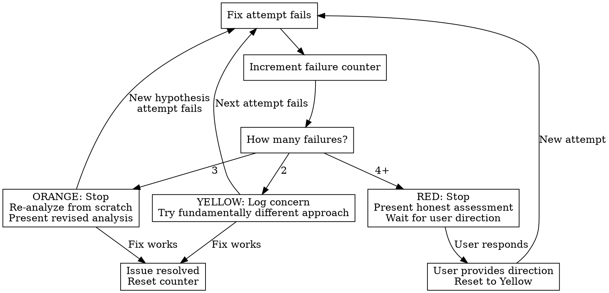

# Error Recovery

## Overview

Agents get stuck: the same approach tried repeatedly, complexity added to fix complexity, one more attempt long past the point of diminishing returns. This skill counts every failed attempt and escalates at fixed thresholds, so retries are bounded and recovery starts before wasted effort compounds.

## When to Use

This skill activates when any of these patterns appear:

- Same error message after 2+ attempted fixes
- A fix for problem A introduces problem B
- File edited 3+ times for the same issue without resolution
- Increasing line count or complexity with each attempt
- "Let me try one more thing" after 2+ failures
- Test suite results getting worse, not better
- Reverting a fix and trying a variation of the same approach

When triggered, it takes priority over whatever strategy is currently failing.

## Failure Counter

Maintain a failure counter for each distinct issue, and state the attempt number before each attempt ("This is attempt N of the current issue"):

```
FAILURE LOG
Issue: [description]
Attempt 1: [what you tried] -> [result]
Attempt 2: [what you tried] -> [result]
Attempt 3: [what you tried] -> [result]  <- STOP HERE
```

**Rules:**
- Increment the counter for every attempted fix, including "small tweaks"
- A variation of the same approach counts as a new attempt
- Reverting and retrying counts as a new attempt
- A failure that appeared while fixing the original issue counts against that issue, not a new one
- The counter resets ONLY when the issue is resolved or the user explicitly resets scope

## Severity Levels

### Yellow -- 2 Failed Attempts

- Log the concern explicitly: "Two attempts have failed for [issue]."
- Identify what both attempts had in common
- The next attempt uses a **fundamentally different** approach
- If you cannot identify a different approach, escalate to Orange immediately

Done when the next attempt differs from both previous ones in approach, not in parameters.

### Orange -- 3 Failed Attempts

- **Stop all fix attempts.**
- Step back completely. Re-read the original error from scratch
- Re-analyze the problem as if seeing it for the first time
- List what you know, what you assumed, and what you have not verified
- Formulate a new hypothesis that contradicts your previous assumptions
- Present the situation to the user: "Three attempts have failed. Here is my revised analysis."

Done when the revised analysis is in front of the user.

### Red -- 4+ Failed Attempts

- **Stop. Continue only on explicit user direction.**
- Present an honest assessment:
  - What you tried (all attempts, briefly)
  - What you learned from each failure
  - What you believe the actual problem might be
  - What you recommend as next steps (including "I may not be able to solve this")
- Wait for user input before proceeding
- If the user says continue, reset to Yellow with the new direction

Done when the user has responded.

## Escalation Flowchart



## Recovery Strategies

When a fix fails, apply these in order:

1. **Re-read the actual error message.** Not your interpretation of it -- the literal text. Errors frequently contain the answer.

2. **Try a fundamentally different approach.** Not a variation. If you were editing config, try code. If you were patching, try replacing. If you were adding, try removing.

3. **Simplify ruthlessly.** Strip the problem to its smallest reproducible case. Remove everything non-essential. Test the simplest possible version.

4. **Verify your assumptions.** Print values. Check types. Confirm the file you think you are editing is the one actually being executed. Confirm the function you think is being called is actually being called.

5. **Escalate with honesty.** Tell the user: "I have tried N approaches. None worked. Here is what I know and what I recommend."

6. **Rollback to last known-good state.** If you have made things worse, undo all changes and return to where things last worked. Start fresh from there.

## Stuck Signatures

These patterns mean the agent is stuck and trigger this skill:

| Signature | What to Do Instead |
|---|---|
| Announcing one more attempt after 3+ failures | Stop. Escalate. |
| Adding complexity to fix complexity | Simplify. Remove code. Reduce moving parts. |
| Changing things at random without reading the error | Read the error. It is telling you something specific. |
| Attributing the failure to the environment (cache, stale build) without checking | Verify the claim. Run a clean build. Check actually. |
| Widening scope instead of narrowing it | Focus on the smallest failing case, not the whole system. |
| Editing the same file repeatedly | Step back. The problem may not be in that file. |
| Asserting a fix works without running it | Run it. Check output. Trust evidence, not expectations. |
| Fixing the test instead of the code | The test is probably right. Fix what it is testing. |

## Guardrails

- Fix first; refactor only once the fix holds. Refactoring while debugging creates two problems.
- Scope down, not up: understand the failing part, not the whole system.

Stop and update the failure counter when you notice:

- You are writing more code to handle an error than the original feature
- You are suppressing errors or warnings instead of fixing them
- Your solution is more complex than the original problem
- You have been working on the same error for more than 10 minutes of active attempts

## Related

Fed by `ascension:fault-diagnosis` when its fix loop stops converging. After recovery, call the Skill tool with "ascension:completion-gate" before claiming the fix holds, and write the test that reproduces the exact failure (`ascension:test-first`); a fix without a regression test is not complete.
