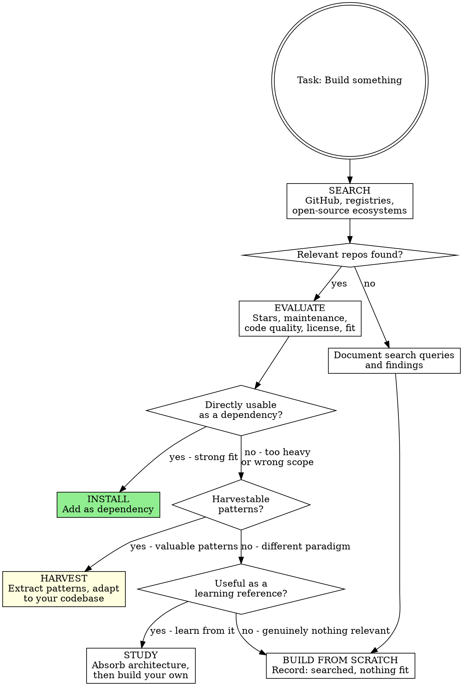
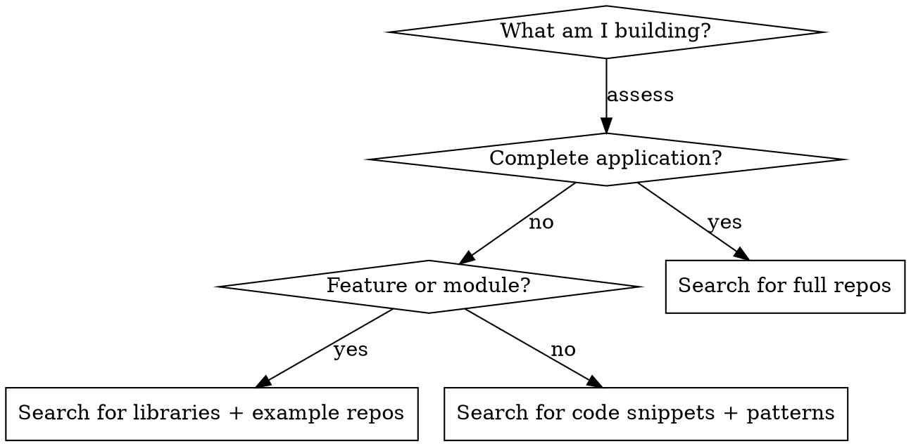

# GitHub Search

## Overview

Before writing a single line of code, determine whether someone on the planet has already solved the same problem and published the result. The strongest engineering move is recognizing when the work has already been done.

Search GitHub repositories, package registries, and open-source ecosystems for existing implementations before building anything new. Harvest the best patterns from multiple projects. Attribute what you borrow. Respect licenses.

## When to Use

- Initiating a new feature or project
- Building something that plausibly exists as open source
- Weighing competing implementation strategies
- Seeking architectural precedents from real-world systems
- Evaluating frameworks, libraries, or tooling choices

Prior art is densest for ubiquitous patterns (auth, CRUD, file handling, search, payments), games (every genre has extensive open-source coverage), utilities for known problem spaces, algorithms and specialized data structures, infrastructure (CI/CD, deployment pipelines, monitoring), and APIs, schemas, or protocols with established conventions.

## The Entry Protocol



**BEFORE building anything:**

1. **SEARCH** -- Query GitHub, package registries, and the broader open-source ecosystem
2. **EVALUATE** -- Assess candidates for quality, relevance, and license compatibility
3. **DECIDE** -- Use as dependency, harvest patterns, study as reference, or build from scratch
4. **DOCUMENT** -- Record what you found and why you chose your path
5. **BUILD** -- With patterns from research, not from assumptions

Done when at least 3 queries across 2 channels are recorded, every candidate has been evaluated against the signals below, the license is verified for anything you will use, and the user has picked from the options you presented.

## Search Methodology

### Where to Search

Cast a wide net across multiple channels before concluding nothing exists.

```
1. GitHub Search: github.com/search (code, repositories, topics)
2. GitHub Topics: github.com/topics/{topic}
3. WebSearch: "github {what you need} {tech stack}"
4. Package registries: npmjs.com, pypi.org, crates.io, rubygems.org, pkg.go.dev
5. Curated lists: awesome-{topic} repositories on GitHub
6. Framework ecosystems: official plugin/extension directories
```

### Effective Querying

**Multi-query discipline** -- Never settle for a single search.

| Query Style | Example | Discovers |
|---|---|---|
| **Literal name** | `tetris javascript` | Exact matches for the concept |
| **Problem statement** | `real-time collaboration websocket` | Solutions targeting the same problem |
| **Stack + pattern** | `vue authentication oauth2` | Technology-specific implementations |
| **Synonym exploration** | `kanban board` / `task tracker` / `project manager` | Same concept, different terminology |
| **Curated collections** | `awesome-react` / `awesome-python` | Community-vetted lists |

**Minimum threshold before declaring "nothing exists":** 3 distinct query formulations across at least 2 search channels.

### What to Search For



## Evaluating Repositories

When assessing discovered repositories, apply these signals systematically.

| Signal | Positive Indicator | Negative Indicator |
|---|---|---|
| **Popularity** | 100+ stars (community-validated) | 0-5 stars (unvetted) |
| **Maintenance** | Commit within 6 months | Dormant 2+ years |
| **Community health** | Active discussions, merged PRs | Hundreds of stale issues, no maintainer response |
| **License** | MIT, Apache 2.0, BSD | GPL (if you need permissive), no license at all |
| **Code discipline** | Tests, types, documentation, clean structure | No tests, no types, tangled code |
| **Dependency footprint** | Minimal, well-known dependencies | 50+ transitive deps, obscure packages |
| **Documentation** | Clear setup instructions, usage examples | Empty or outdated README |
| **Relevance** | Addresses most of your need | Tangentially related |

**Minimum viable candidate:** Has tests, has a license, updated within the past year, README explains usage.

### Quick Evaluation Checklist

```
For each candidate repository:

1. STARS & FORKS: Gauge community trust (100+ stars is a reasonable floor)
2. LAST COMMIT: Anything older than 18 months is a maintenance risk
3. OPEN ISSUES: High count with no maintainer replies signals abandonment
4. LICENSE FILE: No license means you cannot legally use it
5. TEST DIRECTORY: No tests means no confidence in correctness
6. README QUALITY: Poor docs usually correlate with poor internal structure
7. DEPENDENCIES: Check for bloated or unmaintained transitive deps
8. RELEASE CADENCE: Regular releases indicate ongoing investment
```

## Pattern Harvesting

When a repository is not directly consumable but contains valuable patterns, extract intelligently.

### Phase 1: Identify Extractable Value

```
FROM the repository, extract:
- Architectural patterns (how they organized the project)
- Algorithm implementations (how they solved the hard parts)
- Data models (how they structured domain entities)
- Interface designs (how they shaped the public API)
- Error handling approaches (how they manage edge cases)
- Test strategies (how they verify similar functionality)
```

### Phase 2: Adapt to Your Context

```
Extract the pattern, not the file, and rewrite it for your:
- Technology stack
- Naming conventions
- Design system (for UI code)
- Architectural layering
- Internal codebase conventions (call the Skill tool with "ascension:codebase-research" to find them)
```

### Phase 3: Attribute the Source

```
In your codebase or documentation, note:
"Approach inspired by github.com/author/repo - [what was adapted]"
```

## License Compatibility

Before using any code from a discovered repository, verify license compatibility.

| Your Project License | Compatible Source Licenses |
|---|---|
| MIT | MIT, BSD, Apache 2.0, ISC, Unlicense |
| Apache 2.0 | MIT, BSD, Apache 2.0, ISC, Unlicense |
| GPL | Any (GPL is permissive for incoming code) |
| Proprietary | MIT, BSD, Apache 2.0, ISC, Unlicense |
| **Any** | **Never use: No license stated, AGPL (unless you comply fully)** |

**When uncertain:** MIT and Apache 2.0 are safe for virtually any project. GPL requires your project to also be GPL. No license means all rights reserved by the author -- do not use.

## Multi-Source Harvesting

For complex features, the optimal approach often combines patterns from several repositories.

```
Example: Building a real-time collaborative editor

Repo 1 (github.com/x/rich-editor): Polished prosemirror integration
  -> Harvest: Editor initialization pattern, schema definition approach

Repo 2 (github.com/y/crdt-sync): Clean CRDT implementation for text
  -> Harvest: Conflict resolution algorithm, operation transformation logic

Repo 3 (github.com/z/ws-rooms): WebSocket room management
  -> Harvest: Connection lifecycle, reconnection strategy, presence tracking

Result: Your implementation synthesizes the strongest elements from 3 repos,
each designed by specialists in their domain.
```

**Report to the user:**

Present discoveries as labeled options with links. Mark the recommendation with a star.

```
I found [N] relevant repositories. Here are the top candidates:

**A)** [repo-name] — [stars] stars, [license]
   Link: [GitHub URL]
   Extractable: [specific patterns/code worth harvesting]
   Fit: [what percentage of your need it covers]

**B)** [repo-name] — [stars] stars, [license]
   Link: [GitHub URL]
   Extractable: [specific patterns/code worth harvesting]
   Fit: [what percentage of your need it covers]

**C)** [repo-name] — [stars] stars, [license]
   Link: [GitHub URL]
   Extractable: [specific patterns/code worth harvesting]
   Fit: [what percentage of your need it covers]

**D) Multi-source harvest** — Best patterns from all three ⭐ Recommended
   From A: [what to extract]
   From B: [what to extract]
   From C: [what to extract]
   Build from scratch: [what is unique to this project]
   Why: Combines battle-tested patterns from [N] production systems

Check out the repos and pick A, B, C, or D.
```

**YoloMode exception:** Reference and repository selection is ALWAYS interactive — even in YoloMode, present the options and let the user pick. These choices are too impactful to auto-select.

## Guardrails

- Search with at least 3 query formulations across at least 2 channels before concluding nothing exists.
- Evaluate every candidate against the signals above before setting it aside.
- Verify license compatibility before using any code; a repository with no license stays out, whatever its quality.
- Attribute every harvested pattern to its source.
- Record what you searched, what you found, and why you chose your path.
- When nothing matches exactly, or you want to avoid adding a dependency, harvest the pattern rather than the code; a partial match still carries edge cases you have not met yet.
- Report findings to the user with links, popularity metrics, and what you are extracting; the pick is theirs.

## Related

Routed here by `ascension:reference-engine` and `ascension:intent-discovery`. `ascension:codebase-research` is the same discipline pointed at the current repo; harvested patterns pass through it so they land in the project's conventions. `ascension:project-bootstrap` uses this skill to find starter templates.
