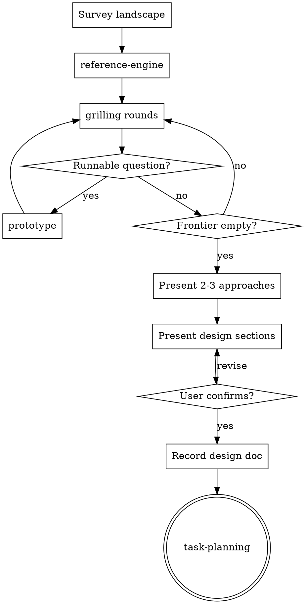

# Intent Discovery

Turn a raw idea into a design the user has actually agreed to, before any code exists.

Users articulate goals, not designs. The gap between "I want X" and "here is how X is built" is where the assumptions live, and every one you leave unspoken is a decision you made on the user's behalf without telling them.

**Skip this only for** typo fixes, imports the user specified exactly, configuration values dictated verbatim, files the user named for deletion, and commands the user supplied verbatim. Everything else gets a design — proportionate to the work, but presented and approved.

## 1. Survey the landscape

Read the project first: files, `CONTEXT.md`, ADRs, documentation, recent commits. Know what exists before proposing what to add.

## 2. Locate references

Call the Skill tool with "ascension:reference-engine". It routes to whichever reference system fits: `github-search` for external implementations, `codebase-research` for internal patterns, `design-research` for visual themes, `ux-patterns` for interface behaviour, `primary-research` for external facts a decision waits on.

Summarise what came back — *"Found references from [sources]: [what is relevant]"* — and carry it into the questions. A reference changes which questions are worth asking.

## 3. Grill

Call the Skill tool with "ascension:grilling". Map the design as a tree, work the **frontier** in rounds, put every open decision to the user with your recommendation attached, and go find the facts yourself rather than asking.

Inside a repository, also call the Skill tool with "ascension:domain-modeling" so terms and hard-to-reverse decisions land in `CONTEXT.md` and ADRs as they settle.

**When a question is genuinely runnable** — does this state model feel right, what should this look like — stop asking and build the answer. Call the Skill tool with "ascension:prototype". A question that needs to be *seen* or *driven* will not resolve in prose.

The grilling ends when the frontier is empty.

## 4. Present approaches

Propose 2-3 genuinely distinct approaches as labelled options (A, B, C) with trade-offs. Lead with the recommendation, mark it, and say why. Cite the references behind each one.

**Approach selection is never auto-picked**, including under YoloMode. Wait for the user.

## 5. Present the design

Scale each section to its complexity: a few sentences for straightforward parts, a few hundred words for the nuanced ones. Cover architecture, components, data flow, error handling, and testing strategy — including which **seams** the tests will live at (`ascension:module-design` for the vocabulary, `ascension:test-first` for why the seams are agreed up front).

Confirm each section before moving to the next. Under YoloMode, present the whole design in one pass and proceed.

## 6. Record it

Write the approved design to `docs/plans/YYYY-MM-DD-<topic>-design.md` and commit it. It becomes the fixed point the Spec axis of `ascension:quality-gate` reviews against, so it needs to be specific enough to be failed.

## 7. Hand off

Call the Skill tool with "ascension:task-planning". That is the only next step — not `ui-engineering`, not any other implementation skill.

If the work is too big for one session, task-planning hands on to `ascension:work-tickets` to slice it into tracer bullets.

## Visual companion

When a question is genuinely *visual* — comparing layouts, judging look-and-feel, showing wireframes or architecture diagrams — a browser-based companion renders mockups and clickable options the user selects directly.

Offer it only when it earns its keep: would they understand this better by seeing it than by reading it? Requirements, scope, and conceptual A/B/C choices stay in the terminal.

Ask before launching (it starts a local web server; it loads no external resources and makes no network requests). Then follow [visual-companion.md](visual-companion.md); scripts live in `scripts/`. Session files persist under `<project>/.ascension/brainstorm/` — remind the user to gitignore `.ascension/`.

## Two things worth saying out loud

**"This is too trivial for design work."** Trivial projects carry the most unchallenged assumptions — even a notes app has a data model, a storage decision, and an interaction model. The design can be three sentences; it still gets presented.

**"The user seems eager to start."** They are eager for the *outcome*. Arriving at the wrong outcome quickly is not faster.

## Workflow

