# Reference Engine

## Overview

Every domain has professional engineering already completed: APIs designed, schemas refined, pipelines battle-tested, patterns hardened. Before building anything, locate the best existing reference, extract its patterns, and build on proven foundations rather than assumptions. When no domain-specific reference skill exists, this skill is the reference system.

## When to Use

This skill is the router. It determines WHICH reference system to engage based on what is being built.

```dot
digraph reference_router {
    rankdir=TB;
    node [shape=box style=filled];

    task [label="Task Received" fillcolor=lightyellow shape=doublecircle];

    classify [label="Classify Task Domain" fillcolor=lightyellow];

    ui [label="UI / Frontend?\n-> ux-patterns\n-> ui-engineering\n-> design-integration" fillcolor="#e8f5e9"];
    website [label="Website Design?\n-> design-research\n-> ux-patterns" fillcolor="#e8f5e9"];
    code [label="Code / Library?\n-> github-search (external)\n-> codebase-research (internal)\n-> pattern-matching" fillcolor="#e8f5e9"];
    api [label="API Design?\n-> API References\n(this protocol)" fillcolor="#fff3e0"];
    database [label="Database / Schema?\n-> Schema References\n(this protocol)" fillcolor="#fff3e0"];
    testing [label="Testing Strategy?\n-> Testing References\n(this protocol)" fillcolor="#fff3e0"];
    devops [label="CI/CD / DevOps?\n-> DevOps References\n(this protocol)" fillcolor="#fff3e0"];
    arch [label="Architecture?\n-> system-design\n-> Architecture References\n(this protocol)" fillcolor="#fff3e0"];
    quality [label="Code Quality?\n-> quality-enforcement\n-> Quality References\n(this protocol)" fillcolor="#fff3e0"];
    perf [label="Performance?\n-> performance-tuning\n-> Perf References\n(this protocol)" fillcolor="#fff3e0"];
    security [label="Security?\n-> security-protocol\n-> Security References\n(this protocol)" fillcolor="#fff3e0"];
    other [label="Other Domain?\n-> Research + Build Reference\n(this protocol)" fillcolor="#fce4ec"];

    task -> classify;
    classify -> ui;
    classify -> website;
    classify -> code;
    classify -> api;
    classify -> database;
    classify -> testing;
    classify -> devops;
    classify -> arch;
    classify -> quality;
    classify -> perf;
    classify -> security;
    classify -> other;
}
```



**Green nodes** = dedicated protocol exists, invoke it.
**Orange nodes** = use reference libraries from THIS protocol.
**Red nodes** = no reference exists yet — research first, then build.

## The Entry Protocol

```
BEFORE building anything:

1. CLASSIFY: What domain is this task in?
2. ROUTE: Does a dedicated reference protocol exist? (ux-patterns, design-research, github-search, codebase-research, etc.)
   -> YES: Call the Skill tool with "ascension:<that skill>"
   -> NO: Continue to step 3
3. SEARCH: Locate reference implementations for this domain
   - External: call the Skill tool with "ascension:github-search" for open-source repos, libraries, and patterns
   - Internal: call the Skill tool with "ascension:codebase-research" for existing conventions and similar code
   - GitHub: Search for gold-standard implementations
   - Documentation: Find official best practices (RFC specs, framework docs, cloud provider guides)
   - Industry leaders: What do Stripe, GitHub, Vercel, AWS do for this?
4. EXTRACT: Isolate the patterns that make these references excellent
5. PRESENT: Show the user your references and recommended approach
6. BUILD: Implement using the reference

Done when at least two references are named, the patterns taken from each are listed with the reason for each, and the user has seen them before any code is written.
```

## Two kinds of reference

A reference is either an **implementation** or a **principle**, and they answer different questions:

| The question | Route to |
|---|---|
| "What does a good one look like?" | The domain libraries below, `ascension:github-search`, `ascension:codebase-research`, `ascension:design-research` |
| "What rule should govern this decision?" | `ascension:canon` — fourteen engineering books distilled into applicable rule sets |
| "What is actually true about this API/spec/library?" | `ascension:primary-research` |

Call the Skill tool with "ascension:canon" when the decision is architectural, when a refactor risks turning into a rewrite, when working in legacy code, when data correctness or operational resilience is at stake, or when domain modelling needs a canonical frame. Pick one book, not the shelf.

## Domain Reference Libraries

### API Design References

**Gold-standard implementations to study:**

| API Style | Reference | Study For |
|-----------|-----------|-----------|
| REST | Stripe API | Resource naming, versioning, error format, pagination, idempotency |
| REST | GitHub API v3 | Hypermedia, conditional requests, rate limiting headers |
| REST | Twilio API | Nested resources, webhooks, status callbacks |
| GraphQL | GitHub API v4 | Schema design, pagination (connections), error handling |
| GraphQL | Shopify Storefront | Query complexity limits, versioning strategy |
| RPC/gRPC | Google Cloud APIs | Proto design, error model, long-running operations |
| Webhooks | Stripe Webhooks | Event types, signing, retry policy, idempotency |
| Real-time | Discord Gateway | WebSocket lifecycle, heartbeats, reconnection, intents |

**API Reference Checklist:**

```
BEFORE designing any API:

1. Resource naming: Use nouns, plural, lowercase
   Reference: Stripe -> /v1/customers, /v1/payment_intents

2. Error format: Consistent error object
   Reference: Stripe -> { error: { type, code, message, param } }

3. Pagination: Cursor-based for real-time data, offset for static
   Reference: GitHub -> Link headers + per_page + page params
   Reference: Stripe -> has_more + starting_after cursor

4. Versioning: URL path or header
   Reference: Stripe -> /v1/ prefix
   Reference: GitHub -> Accept header with version

5. Auth: API keys for server, OAuth for users
   Reference: Stripe -> Bearer token in Authorization header

6. Rate limiting: Return limits in headers
   Reference: GitHub -> X-RateLimit-Limit, X-RateLimit-Remaining, X-RateLimit-Reset

7. Idempotency: Idempotency keys for mutations
   Reference: Stripe -> Idempotency-Key header

8. Filtering/sorting: Consistent query parameter patterns
   Reference: Stripe -> created[gte]=timestamp, status=active
```

### Database Schema References

**Reference patterns by domain:**

| Domain | Schema Pattern | Source |
|--------|---------------|--------|
| Users & Auth | Users -> Roles -> Permissions (RBAC) | Auth0, Supabase auth schema |
| E-commerce | Products -> Variants -> Orders -> LineItems | Shopify schema, Medusa.js |
| Multi-tenant SaaS | Organizations -> Members -> Resources | Clerk, WorkOS patterns |
| CMS | Content -> Versions -> Media -> Taxonomies | Strapi, Payload CMS schema |
| Social | Users -> Posts -> Comments -> Reactions -> Follows | Mastodon, Lemmy schema |
| Messaging | Conversations -> Participants -> Messages | Matrix protocol, Slack data model |
| Scheduling | Events -> Slots -> Bookings -> Availability | Cal.com schema |
| Analytics | Events -> Sessions -> Properties (star schema) | PostHog, Plausible schema |
| Inventory | Products -> Warehouses -> Stock -> Movements | Odoo inventory module |

**Schema Reference Checklist:**

```
BEFORE designing any database schema:

1. Find the domain pattern above (or search GitHub for "[domain] database schema")
2. Study the reference implementation's:
   - Table relationships and foreign keys
   - Indexing strategy
   - Soft delete approach (deleted_at vs status)
   - Audit trail pattern (created_at, updated_at, created_by)
   - Multi-tenancy approach (row-level vs schema-level)
3. Standard columns for EVERY table:
   - id (UUID or ULID, not auto-increment for distributed systems)
   - created_at (timestamp with timezone)
   - updated_at (timestamp with timezone)
4. Naming convention: snake_case for tables and columns
5. Junction tables: {table_a}_{table_b} alphabetically
```

### Testing Strategy References

**Reference frameworks by project type:**

| Project Type | Testing Approach | Tools |
|-------------|------------------|-------|
| React/Vue/Svelte | Component -> Integration -> E2E | Testing Library + Vitest + Playwright |
| API/Backend | Unit -> Integration -> Contract -> E2E | Jest/Vitest + Supertest + Pact |
| CLI Tool | Unit -> Integration -> Snapshot | Jest + mock-stdin + snapshot testing |
| Library/Package | Unit -> Property-based -> Compatibility | Vitest + fast-check + matrix CI |
| Mobile | Component -> Screen -> E2E | Detox (RN), XCTest (iOS), Espresso (Android) |
| Data Pipeline | Unit -> Integration -> Data quality | Great Expectations, dbt tests |
| Infrastructure | Plan -> Apply -> Verify | Terratest, kitchen-terraform |

**Testing Reference Checklist:**

```
BEFORE writing tests:

1. Identify project type -> select testing approach above
2. Test pyramid for this project:
   - Unit tests: the bulk (fast, isolated, mock dependencies)
   - Integration tests: fewer (real dependencies, test interactions)
   - E2E tests: fewest (user flows, critical paths only)
3. What to test:
   - Happy path (minimum viable test)
   - Edge cases from spec (empty, null, max, concurrent)
   - Error paths (invalid input, network failure, timeout)
   - Security paths (injection, auth bypass, privilege escalation)
4. What NOT to test:
   - Framework internals (React renders correctly)
   - Third-party library behavior (axios sends requests)
   - Implementation details (internal state shape)
5. Test naming: describe("[unit]", () => it("should [behavior] when [condition]"))
6. Test data: Use factories/fixtures, not inline magic values
```

### CI/CD Pipeline References

**Reference pipelines by platform:**

| Platform | Source | Key Patterns |
|----------|--------|--------------|
| GitHub Actions | github/starter-workflows | Matrix builds, caching, artifact upload |
| GitHub Actions | Vercel's Next.js workflow | Preview deploys, environment protection |
| GitLab CI | gitlab-org/gitlab | Multi-stage, DAG pipelines, includes |
| CircleCI | circleci/circleci-docs | Orbs, workspace persistence |
| AWS | aws-actions/* | OIDC auth, CodeBuild, ECS deploy |
| GCP | google-github-actions/* | Workload Identity, Cloud Run deploy |

**CI/CD Reference Checklist:**

```
BEFORE setting up CI/CD:

1. Standard pipeline stages:
   Install -> Lint -> Type Check -> Test -> Build -> Deploy

2. Caching strategy:
   - Node: cache node_modules with package-lock.json hash
   - Python: cache .venv with requirements.txt hash
   - Go: cache go/pkg/mod with go.sum hash
   - Rust: cache target/ with Cargo.lock hash

3. Required checks before merge:
   - All tests pass
   - Linting passes
   - Type checking passes
   - Build succeeds
   - Security audit passes (npm audit, pip audit)

4. Deployment strategy:
   - Preview deploys for PRs (Vercel, Netlify, or custom)
   - Staging auto-deploy from main
   - Production manual approval or tag-based

5. Secrets management:
   - Use platform secret stores (GitHub Secrets, Vault)
   - Never echo secrets in logs
   - Rotate on compromise
```

### Code Pattern References

**Reference implementations by language/framework:**

| Pattern | Source | When to Use |
|---------|--------|-------------|
| Error handling (TS) | Effect-TS, neverthrow | Typed errors, Result pattern |
| Error handling (Go) | Standard library | errors.Is/As, wrapping, sentinel errors |
| Error handling (Rust) | thiserror + anyhow | Custom error types + context |
| State machines | XState, Robot | Complex UI state, workflows |
| Event sourcing | EventStoreDB examples | Audit trails, temporal queries |
| CQRS | Axon Framework examples | Read/write separation at scale |
| Repository pattern | Spring Data, TypeORM | Data access abstraction |
| Middleware pattern | Express, Koa, Hono | Request pipeline, cross-cutting concerns |
| Plugin system | Vite, ESLint, Webpack | Extensibility, hooks |
| Queue/worker | BullMQ, Celery | Background jobs, async processing |
| Pub/sub | Redis Streams, NATS | Event-driven communication |
| Rate limiting | Upstash ratelimit | API protection, fair usage |
| Feature flags | Unleash, LaunchDarkly SDK | Progressive rollout, A/B testing |
| Caching | Redis patterns, SWR | Performance, stale-while-revalidate |

**Code Pattern Reference Checklist:**

```
BEFORE implementing a pattern:

1. Identify the pattern needed from the table above
2. Search GitHub for the reference implementation
3. Study HOW it implements the pattern:
   - What's the public API? (how do consumers use it?)
   - What's the internal structure? (how is it organized?)
   - How does it handle errors?
   - How does it handle edge cases?
4. Extract the minimal pattern for your use case
5. Implement following the reference structure
```

### Architecture References

**Reference architectures by scale:**

| Scale | Architecture | Source |
|-------|-------------|--------|
| Solo/MVP | Monolith + managed DB | Rails, Django, Next.js full-stack |
| Small team | Modular monolith | Shopify's approach (components), Laravel modules |
| Growing | Monolith -> extract services | Segment's centrifuge pattern |
| Scale | Microservices + event bus | Netflix OSS, Uber's domain-oriented |
| Serverless | Functions + managed services | SST (sst.dev) patterns, Vercel's architecture |
| Edge | Edge compute + CDN | Cloudflare Workers patterns, Deno Deploy |

### Security References

**Reference implementations by concern:**

| Concern | Source | Key Patterns |
|---------|--------|--------------|
| Authentication | Auth.js (NextAuth) | Session strategy, provider pattern, CSRF protection |
| Authorization | CASL, Casbin | ABAC/RBAC policies, permission checking |
| Input validation | Zod, Valibot | Schema validation at boundaries |
| Rate limiting | Upstash ratelimit | Sliding window, token bucket |
| CORS | Express CORS middleware | Allowlist origins, credentials handling |
| CSP | Helmet.js | Content-Security-Policy headers |
| Secrets | 1Password CLI, Vault | Secret rotation, zero-trust access |
| Encryption | libsodium, Web Crypto | Envelope encryption, key derivation |

### DevOps / Infrastructure References

**Reference patterns by provider:**

| Provider | Source | Covers |
|----------|--------|--------|
| AWS | aws-samples/* | VPC, ECS, Lambda, RDS, S3 patterns |
| GCP | GoogleCloudPlatform/* | Cloud Run, GKE, Pub/Sub, Firestore |
| Azure | Azure-Samples/* | App Service, Functions, Cosmos DB |
| Kubernetes | kubernetes/examples | Deployments, services, ingress, HPA |
| Terraform | hashicorp/terraform-provider-* | Module patterns, state management |
| Docker | docker/awesome-compose | Multi-service compose patterns |
| Monitoring | grafana/grafana | Dashboard templates, alert rules |

### Documentation References

| Doc Type | Source | Study For |
|----------|--------|-----------|
| API docs | Stripe docs | Clear examples, language tabs, copy-paste ready |
| README | Best-of-breed GitHub READMEs | Badges, quick start, feature list, contributing |
| Architecture | arc42, C4 model | Decision records, context diagrams |
| Runbooks | PagerDuty runbooks | Incident response, escalation |
| Changelogs | Keep a Changelog | Versioning, categorization |

## The Research Process

When no specific reference library above covers your domain:

```
1. GitHub Search:
   - "[domain] [language] example" (e.g., "payment processing typescript example")
   - "[domain] boilerplate" or "[domain] starter"
   - Sort by stars, filter to recently updated

2. Official Documentation:
   - Framework guides (Next.js docs, Django docs, Rails guides)
   - Cloud provider best practices (AWS Well-Architected, GCP Architecture Center)
   - RFC specifications (for protocols, standards)

3. Industry Leaders:
   - What does Stripe do for payments?
   - What does GitHub do for API design?
   - What does Vercel do for deployment?
   - What does Cloudflare do for edge computing?

4. Open Source Implementations:
   - Search for mature, well-maintained projects in the same domain
   - Examine how they structure their code
   - Cherry-pick patterns from 3+ implementations
```

## Multi-Reference Cherry-Picking

The best results come from combining references from multiple sources:

```
Example: Building a SaaS billing system

Reference 1 (Stripe API patterns):
  -> Take: Resource naming, error format, idempotency
  -> Take: Webhook event structure and signing

Reference 2 (Lago open-source billing):
  -> Take: Usage-based metering data model
  -> Take: Invoice generation pipeline

Reference 3 (Supabase auth schema):
  -> Take: Multi-tenant organization structure
  -> Take: Row-level security patterns

Reference 4 (Cal.com):
  -> Take: Subscription lifecycle state machine
  -> Take: Webhook delivery with retry logic

Result: A billing system built on patterns from 4 production-tested systems,
each designed by teams who spent months on exactly these problems.
```

## Reference Quality Criteria

Not all references are equal. Evaluate by:

| Criterion | Weight | What to Check |
|-----------|--------|---------------|
| Production usage | High | Is this deployed in production by real organizations? |
| Community size | High | Stars, contributors, download counts |
| Maintenance | High | Recent commits, responsive issue handling |
| Documentation | Medium | Are patterns documented and explained? |
| Test coverage | Medium | Does the reference have strong tests? |
| Security audited | Medium | Has it passed security review? |
| Simplicity | Medium | Is the pattern minimal and clear? |
| Portability | Low | Can the pattern be adapted to other stacks? |

## Guardrails

- Locate at least 2 reference implementations before building; for complex systems, cherry-pick from 3 or more sources.
- Design APIs against Stripe, GitHub or Twilio patterns; schemas against a domain reference; CI/CD against starter workflows; security against established auth libraries; tests against a testing strategy reference; architecture against a reference architecture.
- Present your references and approach to the user, and say why you chose each pattern from each reference.
- When no domain library above fits, look to adjacent domains, similar patterns and analogous systems before concluding there is no reference.
- When you believe you can improve on a reference, show the reference first, then propose the improvement.
- Update references when you discover superior ones.

## Related

This skill is the router: the graph above sends UI work to `ascension:ux-patterns`, websites to `ascension:design-research`, external code to `ascension:github-search` and this repo's own conventions to `ascension:codebase-research`. Invoked by `ascension:intent-discovery` during the "what exists?" phase, and by `ascension:specification-first` and `ascension:task-planning` to ground specs and plans.
