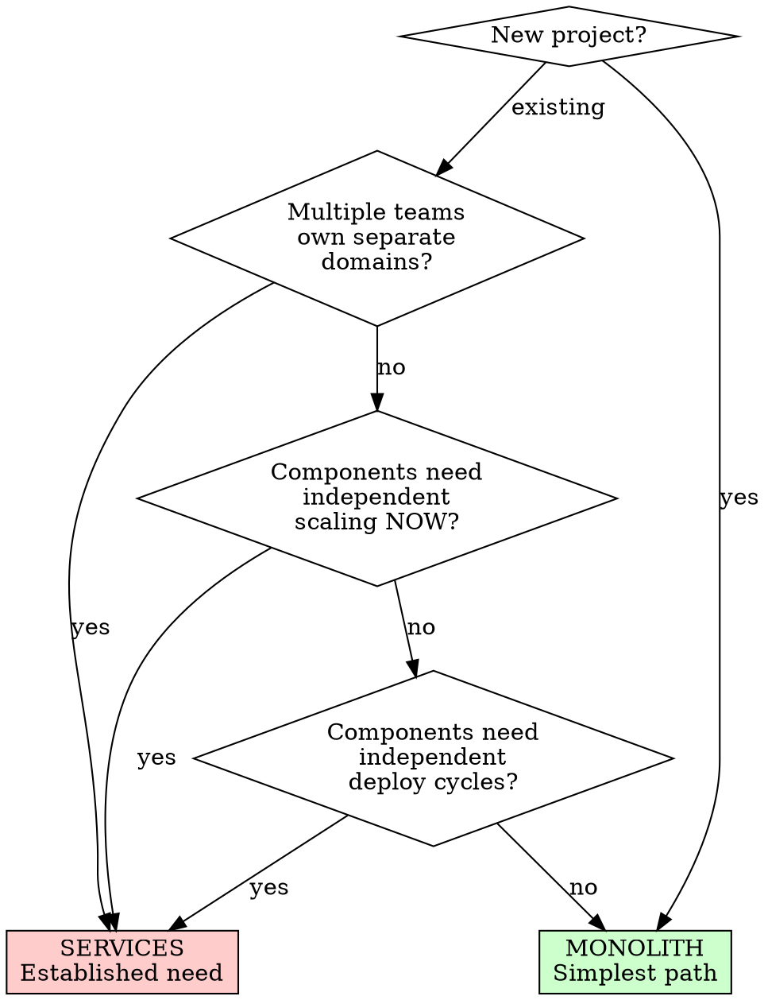

# System Design

## Overview

Select the simplest architecture that satisfies the current requirements, and introduce complexity only when evidence demands it. Every structural decision is driven by a requirement that exists now, not a speculative future one.

## When to Use

Before:
- Selecting a database
- Designing an API
- Organizing a new project
- Introducing a caching layer
- Adding message queues or event systems
- Choosing authentication strategy
- Deciding on monolith vs services

Especially when someone says "we might need to scale" or "what if we need X later", or when multiple valid approaches exist.

## The Entry Protocol

Before making any structural decision:

1. **Identify** the concrete, current requirement that drives this choice.
2. **Compare**: what is the simplest option that satisfies it?
3. **Justify** anything more complex. With no justification, take the simple option; with one, record the requirement driving the complexity.
4. **Decide**, document, move on.

Done when the decision record names the requirement, the option chosen, and the simpler option it beat.

## Decision Frameworks

### Monolith vs Services



**Default: Monolith.** Extract services only when a specific component demonstrates it requires independent scaling or deployment.

### Database Selection

| Requirement | Select | Rationale |
|-------------|--------|-----------|
| Structured data, relationships, transactions | PostgreSQL | ACID guarantees, mature, handles JSON and full-text search |
| Document-oriented, genuinely variable schema per record | MongoDB | Only when schema truly differs per document |
| Key-value, caching, session storage | Redis | In-memory speed, built-in TTL |
| Full-text search at volume | Elasticsearch | Purpose-built for search workloads |
| Time-series data (metrics, logs) | TimescaleDB / InfluxDB | Optimized for time-indexed writes |
| Graph traversal is the primary query model | Neo4j | Only when traversal IS the product |
| Embedded, zero-config, single-user | SQLite | Simplest possible, no server needed |

**Default: PostgreSQL.** It handles JSON, full-text search, and most workloads adequately. Switch only when PostgreSQL demonstrably cannot meet a requirement.

### API Design

| Context | Select | Rationale |
|---------|--------|-----------|
| CRUD operations, public-facing API | REST | Universal, cacheable, well-understood |
| Complex nested data, client-controlled shape | GraphQL | Eliminates over/under-fetching |
| Internal service-to-service, high throughput | gRPC | Binary protocol, generated stubs, streaming |
| Real-time bidirectional communication | WebSockets | Persistent connection, low latency |
| Simple webhooks, event notification | REST callbacks | Stateless, easy to troubleshoot |

**Default: REST.** Adopt GraphQL only when clients genuinely need flexible queries. Adopt gRPC only for internal services where throughput is measured and proven insufficient with REST.

### Authentication Strategy

| Context | Select | Rationale |
|---------|--------|-----------|
| Standard web application | Session-based (cookies) | Simple, secure, server-controlled revocation |
| SPA + API on different origins | JWT (short-lived) + refresh tokens | Stateless API auth across domains |
| Third-party login | OAuth 2.0 / OIDC | Delegated authentication standard |
| Machine-to-machine | API keys + HMAC | Simple, auditable |
| Multi-tenant SaaS | OIDC + tenant-scoped tokens | Isolation per tenant |

**Default: Session-based auth with httpOnly cookies.** JWTs are not inherently more secure. Use them only when stateless authentication across domains is a concrete requirement.

### Caching Strategy

```
BEFORE introducing a cache:

1. Is there actually a measured performance problem?
2. Can the database query be optimized instead?
3. Is the data read-heavy with infrequent writes?

Only if YES to 1, NO to 2, YES to 3: Introduce cache.
```

| Layer | Mechanism | Use When |
|-------|-----------|----------|
| Application | In-memory (LRU) | Single instance, small dataset |
| Distributed | Redis / Memcached | Multi-instance, shared state |
| HTTP | CDN / reverse proxy | Static assets, public pages |
| Database | Query cache / materialized views | Expensive aggregations |

**Default: No cache.** Optimize queries first. Introduce caching only after measuring a bottleneck.

### Event-Driven Architecture

```
BEFORE introducing a message queue:

1. Do you need asynchronous processing? (Email delivery, image processing)
2. Do producers and consumers need to scale independently?
3. Do you need guaranteed delivery across service boundaries?

If NO to all: Direct function calls are sufficient.
```

| Need | Mechanism | Rationale |
|------|-----------|-----------|
| Simple task queue | Redis + BullMQ / Celery | Lightweight, familiar |
| Event streaming, replay | Kafka | High throughput, log-based |
| Cloud-native messaging | SQS / Cloud Pub/Sub | Managed, serverless |
| Complex routing | RabbitMQ | Flexible routing, mature |

**Default: Direct function calls.** Queues add operational complexity. Introduce them only when async processing or decoupling is an established requirement.

## File Organization Conventions

**Organize by capability, not by layer:**

```
# AVOID: organized by layer
src/
  controllers/
  models/
  services/
  validators/

# PREFER: organized by capability
src/
  users/
    user.controller.ts
    user.service.ts
    user.model.ts
    user.test.ts
  orders/
    order.controller.ts
    order.service.ts
    order.model.ts
    order.test.ts
  shared/
    database.ts
    auth.middleware.ts
```

Capability-based organization keeps related code together. Changing one capability touches one directory.

## Guardrails

- Build for the load measured today; write expected growth down as a requirement to revisit, not as infrastructure.
- Pick technology for the requirement it meets, and name that requirement in the decision record; "modern" and "industry standard" are not requirements.
- One database until a second, distinct access pattern is named.
- Direct calls for synchronous workflows; a queue appears only where async processing or decoupling is the established requirement.
- A single team ships a monolith.
- When a flexible schema looks attractive, name the fields that actually vary per record; PostgreSQL's JSON columns cover variation without a second store.
- Cache after measuring, and after the query has been optimized.

Stop and simplify when you notice: an MVP architecture past five components, or a component whose only justification is future growth.

## Module shape

Structural decisions above pick the *pieces*. The shape of each piece — how much behaviour sits behind how small an interface, and where the seam goes — is its own decision with its own vocabulary. Call the Skill tool with "ascension:module-design" before designing an interface, and use its words (module, interface, depth, seam, adapter, leverage, locality) rather than "component", "service", or "boundary".

Inside a repository, call the Skill tool with "ascension:domain-modeling" so the names you choose match `CONTEXT.md` and the hard-to-reverse choices here land as ADRs.

## Related

- `ascension:performance-tuning` — the measurement that earns a cache or a queue
- `ascension:project-bootstrap` — file organization and initial setup
- `ascension:security-protocol` — auth patterns and data flow security
