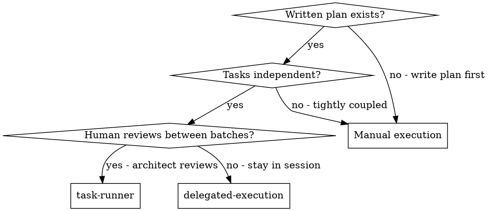

# Task Runner

## Overview

Load the plan, scrutinize it, execute tasks in batches, and pause for architect review between batches.

Plans contain errors, ambiguities, and outdated assumptions. Every task is read critically before it runs.

**Announce at start:** "I'm applying the task-runner skill to execute this implementation plan."

## When to Use

**Use task-runner when:**
- A written implementation plan exists (from task-planning or equivalent)
- Tasks should execute in batches with human review between them
- The architect wants to inspect progress and make corrections between batches
- Working in a parallel session (separate from the planning session)

**Use delegated-execution instead when:**
- Staying in the same session (no context switch)
- Prefer automated two-stage review (spec + quality) over human review
- Tasks are independent and can be dispatched to fresh subagents

**Use manual execution when:**
- No written plan exists yet
- Tasks are tightly coupled and need continuous human guidance
- Exploratory work where a plan would be premature

## The Entry Protocol

Before beginning plan execution, verify ALL of these:

1. **Plan exists and is accessible** - You have a path to a written plan file
2. **Plan has been scrutinized** - You have critically read every task and flagged concerns
3. **Concerns are addressed** - Questions and ambiguities have been raised and answered
4. **Tests pass at baseline** - Existing tests pass before any changes are made
5. **Branch is clean** - Working in a feature branch (not main/master), no uncommitted changes
6. **Worktree is configured** - Call the Skill tool with "ascension:workspace-isolation" to set up the git worktree
7. **Task checklist is populated** - All tasks loaded into a tracking checklist

Done when all seven hold. A failing gate is resolved before Step 1 starts.

## The Process

### Step 1: Load and Scrutinize Plan
1. Read the plan file
2. Review critically -- flag any questions or concerns about each task
3. If concerns: Raise with your human partner before starting
4. If no concerns: Build a task checklist and proceed

Done when every task has been read and every concern raised has an answer.

### Step 2: Execute Batch
**Default batch size: 3 tasks**

For each task:
1. Mark as in_progress
2. Follow each step precisely (plan provides granular steps)
3. Run verifications as specified
4. Mark as completed

Done when every task in the batch is marked completed with its verification output in hand.

### Step 3: Report
When batch completes:
- Call the Skill tool with "ascension:completion-gate" before asserting anything passed
- Show what was implemented
- Show verification output
- Say: "Ready for feedback."

### Step 4: Continue
Based on feedback:
- Apply changes if needed
- Execute next batch
- Repeat until all tasks are done

### Step 5: Finalize

After all tasks are complete and verified:
- Announce: "I'm applying the merge-protocol skill to finalize this work."
- Call the Skill tool with "ascension:merge-protocol"
- Follow that skill to verify tests, present options, execute choice

## When to Stop and Ask

Stop executing and ask your partner when you notice:
- A blocker mid-batch (missing dependency, test failure, unclear instruction)
- Critical gaps in the plan that prevent starting
- An instruction you do not understand
- Verification failing repeatedly

Ask for clarification rather than guessing.

## When to Revisit Earlier Steps

**Return to Scrutiny (Step 1) when:**
- Partner updates the plan based on your feedback
- The fundamental approach needs rethinking

## Guardrails

- Read each task critically before marking it in_progress.
- Run the plan's verifications after each task.
- Stop and ask when blocked.
- Report the completed batch and wait for feedback before starting the next, even when the next tasks look easy; the batch boundary is where errors get caught before they compound.
- When a task looks wrong or a better route appears, raise it with your partner before changing course, so the plan changes on the record.
- Work on a feature branch; implementation on main/master happens only with the user's explicit consent.

## Related

`ascension:task-planning` produces the plan this skill executes. `ascension:delegated-execution` is the same-session alternative with automated two-stage review instead of human-reviewed batches. Tasks that write new code call `ascension:test-first`; a task that hits an unexpected failure calls `ascension:fault-diagnosis`.
