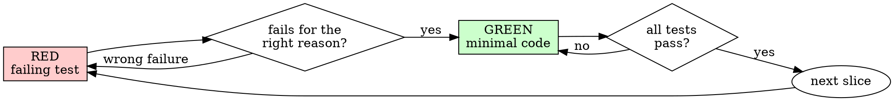

# Test-First Development

Write the test first. Watch it fail. Write the minimum code to pass. Repeat.

The failure is the point: a test you never watched fail is a test you have no evidence about. Tests written after the code pass immediately, and passing immediately proves only that the test agrees with whatever you built — including the parts you built wrong.

While exploring the codebase, read `CONTEXT.md` if it exists so test names and interface vocabulary match the project's language, and respect the ADRs covering the area.

## Seams: where tests go

A **seam** is the public interface you test at — the place where you observe behaviour without reaching inside. Tests live at seams, never against internals.

**Test only at pre-agreed seams.** Before writing any test, write down the seams under test and confirm them with the user: *"The public interface here is X — which seams should we test?"* No test is written at an unconfirmed seam.

You cannot test everything. Agreeing the seams up front is how the effort lands on critical paths and complex logic instead of spreading evenly over every edge case.

When the *shape* of the interface is itself in question — how deep the module is, where the seam belongs, what it should expose — call the Skill tool with "ascension:module-design" for the vocabulary. It is a reference to consult, not a session to run.

## The loop



### RED — write the failing test

One minimal test describing the expected behaviour, named for the capability it proves.

<Good>
```typescript
test('retries failed operations up to 3 times', async () => {
  let callCount = 0;
  const unstableOp = () => {
    callCount++;
    if (callCount < 3) throw new Error('transient failure');
    return 'done';
  };

  const outcome = await withRetry(unstableOp);

  expect(outcome).toBe('done');
  expect(callCount).toBe(3);
});
```
Describes the behaviour, exercises real code, one concern.
</Good>

<Bad>
```typescript
test('retry works', async () => {
  const spy = jest.fn()
    .mockRejectedValueOnce(new Error())
    .mockRejectedValueOnce(new Error())
    .mockResolvedValueOnce('done');
  await withRetry(spy);
  expect(spy).toHaveBeenCalledTimes(3);
});
```
Vague name; asserts on mock interactions rather than behaviour.
</Bad>

### Verify RED — watch it fail

Run it. Confirm the test **fails** rather than errors, that the message matches what you expect, and that it fails because the behaviour is missing rather than because of a typo.

If it passes, you are describing behaviour that already exists — rewrite the test.

### GREEN — minimal code

The simplest code that makes the test pass. No speculative options, no anticipating the next test.

<Good>
```typescript
async function withRetry<T>(fn: () => Promise<T>): Promise<T> {
  for (let attempt = 0; attempt < 3; attempt++) {
    try {
      return await fn();
    } catch (e) {
      if (attempt === 2) throw e;
    }
  }
  throw new Error('unreachable');
}
```
</Good>

<Bad>
```typescript
async function withRetry<T>(
  fn: () => Promise<T>,
  opts?: {
    maxAttempts?: number;
    backoffStrategy?: 'linear' | 'exponential';
    onAttempt?: (n: number) => void;
  }
): Promise<T> { /* ... */ }
```
Three options no test asked for.
</Bad>

### Verify GREEN — watch it pass

Run it. The test passes, the other tests still pass, and the output is clean. If the test fails, fix the code rather than the test.

Then take the next slice.

## Anti-patterns

- **Implementation-coupled** — mocks internal collaborators, tests private methods, or verifies through a side channel (querying the database directly instead of reading back through the interface). The tell: the test breaks on a refactor when behaviour has not changed.

  ```typescript
  // bad: bypasses the interface to verify
  await createUser({ name: 'Alice' });
  const row = await db.query('SELECT * FROM users WHERE name = ?', ['Alice']);

  // good: verifies through the interface
  const user = await createUser({ name: 'Alice' });
  expect((await getUser(user.id)).name).toBe('Alice');
  ```

- **Tautological** — the assertion recomputes the expected value the way the code does, so it passes by construction and can never disagree with the implementation.

  ```typescript
  // bad: expected value derived the same way the code derives it
  const expected = items.reduce((sum, i) => sum + i.price, 0);
  expect(calculateTotal(items)).toBe(expected);

  // good: an independent, known literal
  expect(calculateTotal([{ price: 10 }, { price: 5 }])).toBe(15);
  ```

  Expected values come from an independent source of truth: a known-good literal, a worked example, the spec.

- **Horizontal slicing** — all the tests first, then all the implementation. Bulk tests verify *imagined* behaviour: you test the shape of things rather than what a caller can do, and you commit to a test structure before understanding the implementation. Work in **vertical slices** instead — one test, one implementation, repeat — each slice a **tracer bullet** responding to what the last one taught you.

## Mocking

Mock at **system boundaries** only: external APIs, time and randomness, sometimes the database (prefer a real test database or an in-memory stand-in), sometimes the filesystem.

Do not mock your own modules, internal collaborators, or anything you control. Needing to mock everything means the code is too coupled — inject the dependency instead (`ascension:module-design`).

Prefer SDK-shaped interfaces over one generic fetcher, so each mock returns one specific shape and no conditional logic is needed in test setup:

```typescript
// good: independently mockable
const api = {
  getUser: (id) => fetch(`/users/${id}`),
  createOrder: (data) => fetch('/orders', { method: 'POST', body: data }),
};

// bad: the mock needs an if-cascade
const api = { fetch: (endpoint, options) => fetch(endpoint, options) };
```

## Rules of the loop

- **Red before green.** The failing test first, then only enough code to pass it.
- **One slice at a time.** One seam, one test, one minimal implementation per cycle.
- **Refactoring is not part of the loop.** It belongs to review (`ascension:quality-gate`), not the red-green cycle.
- **Code written before its test does not count as tested.** Delete it and build from the test — kept "as reference", it steers the test toward what you already wrote, which is testing after with extra steps.

## Exceptions

Prototypes are exempt by design — a prototype is throwaway code answering one question, and `ascension:prototype` says so explicitly. Generated code and configuration files are exempt. Anything else, confirm with the user rather than deciding alone.

## When stuck

| Problem | What it means |
|---|---|
| Do not know how to write the test | Write the API you wish existed, then the assertion. |
| The test is complicated | The design is complicated. Simplify the interface. |
| Must mock everything | The code is too coupled. Inject dependencies. |
| The setup is enormous | Extract helpers; if it stays heavy, the seam is in the wrong place. |
| Hard to test | Hard to test means hard to use. Listen to it. |

## Further reading

`testing-anti-patterns.md` in this directory covers mock-validation, test-only methods on production classes, and mocking without understanding the dependency chain.

---
*The seam discipline, tautological-test, and vertical-slice material is adapted from [mattpocock/skills](https://github.com/mattpocock/skills) (MIT).*
