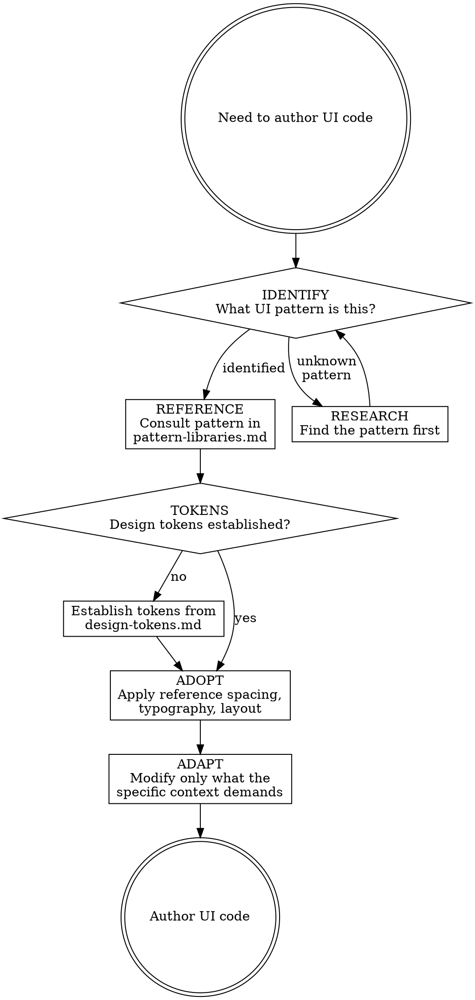

# UX Patterns

## Overview

Every UI element traces to a documented UX pattern or design system component, and every value to a design token. A reference you can cite is what separates professional UI from the amateur look of generated UI.

## When to Use

- Web applications (SaaS, dashboards, admin panels)
- Landing pages and marketing sites
- Game interfaces (menus, HUDs, inventories, shops)
- CLI interfaces (output formatting, interactive prompts)
- Mobile applications
- Component libraries
- Any visual output a human will perceive, prototypes included

## The Entry Protocol

**BEFORE authoring ANY UI code, execute every phase:**

1. **IDENTIFY** -- What UI pattern is this? (navigation, form, data table, modal, card, etc.)
2. **REFERENCE** -- Consult the pattern in `pattern-libraries.md`
3. **TOKENS** -- Confirm design tokens are established for this project (see `design-tokens.md`)
4. **ADOPT** -- Apply the reference spacing, typography, layout, and interaction patterns
5. **ADAPT** -- Modify only what the specific context necessitates
6. **AUTHOR** -- Write the UI code

Done when the pattern is named with its entry in `pattern-libraries.md`, a token exists for every value the component uses, and every item in the Component Validation Checklist below is ticked.

## Design Token Requirements

Every UI project must define these tokens BEFORE any component code:

| Token Category | What to Define | Why It Matters |
|---|---|---|
| **Colors** | Primary, secondary, neutral scale (50-950), semantic (error, success, warning, info) | Eliminates "random color" syndrome |
| **Typography** | Font family (max 2), size scale (xs through 4xl), weight scale (normal, medium, semibold, bold), line heights | Typography carries most of the perceived visual quality |
| **Spacing** | Base unit (4px or 8px), scale (xs: 4px through 3xl: 64px) | Systematic spacing produces a professional feel |
| **Border Radius** | Scale: none, sm, md, lg, full | Ensures consistent component shapes |
| **Shadows** | 3-4 elevation levels (sm, md, lg, xl) | Establishes clear depth hierarchy |
| **Breakpoints** | sm (640px), md (768px), lg (1024px), xl (1280px) minimum | Responsive behavior from the start |
| **Z-index** | Scale: dropdown(10), sticky(20), modal(30), popover(40), toast(50) | Prevents z-index conflicts |

Consult `design-tokens.md` for ready-to-use token templates by project classification.

## Pattern Lookup Methodology

| What you are building | Pattern family |
|---|---|
| SaaS, dashboard, admin panel | SaaS patterns (data-dense, navigation-heavy) |
| Game interface | Game UI patterns (dark theme, bold, animated) |
| Landing page, marketing site | Marketing patterns (conversion-focused, hero sections) |
| Developer tool, CLI | Dev tool patterns (monospace, high contrast, minimal) |
| Online store | E-commerce patterns (product-focused, trust signals) |
| Anything else | General UI patterns (clean, accessible, standard) |

Consult `pattern-libraries.md` for the complete reference organized by project classification and pattern category.

## Hallmarks of Amateur UI (Anti-Patterns)

These are the unmistakable signatures of AI-generated amateur UI. Every one represents a failure to consult references.

| Anti-Pattern | Why It Looks Amateur | What Professionals Do |
|---|---|---|
| **Erratic spacing** | No grid system, gaps feel random, padding varies between sibling elements | Consume spacing tokens. Every gap is a token value. |
| **Ad-hoc colors** | Colors selected per-component, no unified palette, too many distinct hues | Define the complete palette FIRST. Every color references a token. |
| **Disorganized typography** | Mismatched sizes, inconsistent line heights, too many weights, weak hierarchy | Maximum 2 font families. Adhere to the type scale. Heading hierarchy is deliberate. |
| **Flat visual hierarchy** | Everything identical in size and weight, nothing draws the eye, impossible to scan | Primary actions are visually dominant. Secondary elements are subdued. Vary size, weight, color, contrast. |
| **Inconsistent corners** | Mix of sharp and rounded corners, varying border widths on similar elements | Define a border-radius scale. Same component type = same radius. |
| **Placeholder content** | "Lorem ipsum", "User Name", "Description here", "Item 1" | Use realistic content that demonstrates actual data shapes and lengths. |
| **Missing interaction states** | Buttons ignore the cursor, links are ambiguous, no keyboard focus ring | Define interaction states (hover, focus, active, disabled) for ALL interactive elements. |
| **Center-everything layout** | Default AI behavior: center all text, content, and sections | Use left-aligned layouts with proper grid. Center only intentionally (hero headlines, CTAs). |
| **Uniform text walls** | Every paragraph, label, and description uses the same font-size and weight | Vary weight and size. Labels are smaller and lighter. Headings are larger and bolder. Descriptions use muted color. |
| **Missing non-happy states** | Only "populated" UI exists, no skeleton loaders, no error messages | Design all states: empty, loading (skeleton), error, partial, success. |
| **Oversized components** | Buttons too tall, inputs too wide, cards fill the entire viewport | Use standard sizing. Buttons: 36-44px height. Inputs: 36-40px. Cards: constrain max-width. |
| **No whitespace rhythm** | Content crammed together or floating in excessive space | Sections have consistent vertical rhythm. Related items are close. Unrelated items have clear separation. |
| **Gratuitous effects** | Random gradients, shadows on everything, unnecessary animations | Effects serve purpose. Shadows indicate elevation. Gradients are subtle. Animations are functional. |
| **Round-number spacing** | Using 10px, 20px, 30px instead of a system | Use 4px or 8px base unit. Spacing values: 4, 8, 12, 16, 24, 32, 48, 64. |

## Component Validation Checklist

Before authoring any component, verify ALL items:

- [ ] Design tokens established for this project (colors, typography, spacing, radii, shadows)
- [ ] Pattern identified from `pattern-libraries.md`
- [ ] Spacing consumes token scale (no arbitrary px values)
- [ ] Typography consumes type scale (no arbitrary font-size)
- [ ] Colors drawn from defined palette (no hex literals)
- [ ] Border radius drawn from defined scale
- [ ] Hover/focus/active/disabled states defined for all interactive elements
- [ ] Responsive behavior specified for at least mobile and desktop
- [ ] Realistic content used (no placeholder text)
- [ ] Accessibility verified: contrast ratios (4.5:1 body text, 3:1 large text), aria labels, keyboard navigation
- [ ] Empty state designed
- [ ] Loading state designed (skeleton preferred over spinner)
- [ ] Error state designed

The component is ready to author when every item is ticked.

## Guardrails

- Establish tokens before the first component, even when the logic has to come first; they are quick to set up and the logic does not depend on them.
- When a value you need is not in the scale, add it to the tokens rather than hardcoding it once.

Stop and return to IDENTIFY when you notice:
- a hex literal or pixel value that is not a token (`color: #3b82f6`, `padding: 10px`)
- a font size outside the type scale
- a component, form, or dashboard written without its pattern looked up in `pattern-libraries.md`
- hover or focus states left for later
- "Lorem ipsum" or "Example text" in the output
- every element centered
- a gradient or shadow that signals no elevation or purpose

Remove the offending code and restart from step 1.

## Related

Invoked by `ascension:intent-discovery` when the design involves UI, and required of UI subagents under `ascension:delegated-execution`. `ascension:ui-engineering` covers implementation, `ascension:design-integration` adopting an existing design system, and `ascension:design-research` the page-level layout.

**Supporting files:**
- `pattern-libraries.md` -- Complete pattern reference by project classification and category
- `design-tokens.md` -- Ready-to-use token templates by project classification
